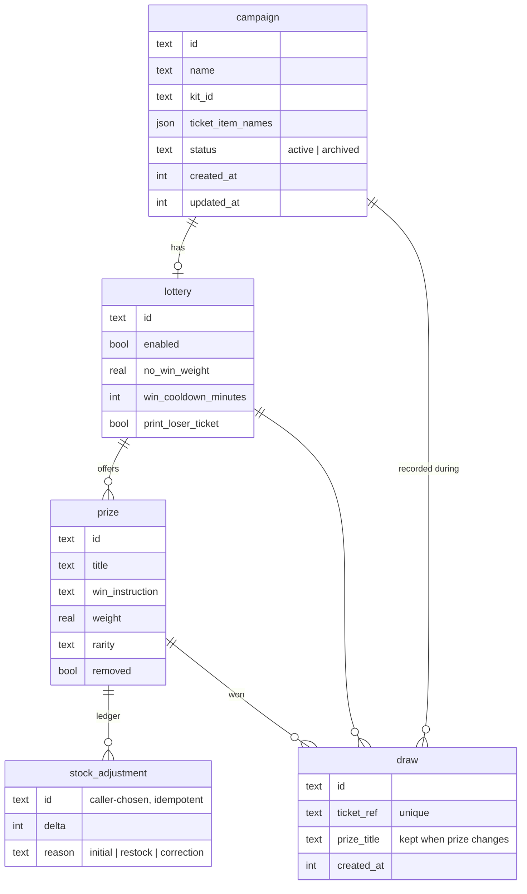

The engine owns one SQLite database, `apps/engine/data/dither-booth.sqlite`, which on the booth is a symlink to `/mnt/ssd/dither-booth/data/`. The schema is Drizzle (`apps/engine/src/db/internal/db.schema.ts`); migrations are plain SQL in `apps/engine/drizzle/`.

## Tables

Plus three singletons (one row, `id = 1`, enforced by a CHECK):

| Table               | Holds                                                                                                                                                                                                                                                                |
| ------------------- | -------------------------------------------------------------------------------------------------------------------------------------------------------------------------------------------------------------------------------------------------------------------- |
| `print_config`      | The booth's print tuning: dither mode, colour scheme, serpentine, exposure, saturation, shadows, highlights, tone gamma, threshold, rotation, and the ticket orientation (`upside_down`). Ranges are CHECK constraints. Device tuning only — nothing event-specific. |
| `darkroom_access`   | The Darkroom PIN's argon2id hash.                                                                                                                                                                                                                                    |
| `kiosk_maintenance` | The **manual** maintenance switch and when it changed. The printer reason is never stored.                                                                                                                                                                           |

## Event lifecycle

Events (`campaign`) are **never deleted**.

- `status` is `active` or `archived`. A partial unique index, `campaign_single_active_idx`, allows **at most one** active campaign.
- `replaceEvent` archives the active campaign and creates the next one **in the same transaction**. The archived campaign's lottery, prizes, ledger and draws stay exactly as they were.
- Everything reads and draws through the active campaign: `getCurrentEvent`, `listDraws`, the receipt settings, the draw, `getLotteryStatus`. A lottery is drawn against only while it belongs to the active campaign **and** is enabled.
- Every **visit** inserts a `draw` row, which allocates its ticket number. It records `campaign_id` (the event active then, null if none) and `lottery_id`, set only while that event's lottery was enabled. Only rows with a `lottery_id` are **draws**: `listDraws` lists the active event's draws, and a lookup by ticket number also finds a lottery-off visit, as `outcome: "no-lottery"`. `getLotteryStatus` counts draws the same way.
- Every event write (campaign, lottery, prizes, stock) moves `updated_at`.
- Ticket numbers (`ticket_ref`) stay **unique across all events**, archived included, so one always points at one visit.

## Stock ledger

Prize stock is **never stored as a number**. `stock_adjustment` is append-only:

- remaining = Σ `delta` − winning draws of that prize;
- `totalQuantity` = Σ `delta` (stock ever allocated, net of corrections).

`apps/engine/src/domains/lottery/internal/lottery.stock.ts` is the only place either is computed.

- Creating a prize writes an `initial` entry.
- `restockPrize({ prizeId, delta, adjustmentId })` writes `restock` (positive) or `correction` (negative). The caller picks `adjustmentId` when the change is first requested and reuses it on retries, so it applies **once**. A reused id for a different change is `CONFLICT`; removing more than what's left is `BAD_REQUEST`.
- A win takes its unit by inserting its `draw` row, inside the draw transaction.

Deltas commute with kiosk wins: a restock never needs to know the current stock, and an admin form can't go stale.

**Triggers.** `drizzle/0011_stock_ledger.sql` creates two triggers that refuse an adjustment or a win that would take stock below zero. drizzle-kit doesn't track triggers, and rebuilding `draw` or `stock_adjustment` would drop them; `db.migrations.test.ts` fails if they go missing.

## Kits

An event's photo receipt look is its **kit**, `campaign.kit_id`.

- `KIT_IDS` in `packages/shared/src/isomorphic/kits.ts` lists the kits this release ships. `DEFAULT_KIT_ID` (`tartines`) is used when an event names none.
- `kit_id` is free text, no CHECK and no default, validated in code: `createEvent` and `updateEvent` accept shipped kits only. **Adding a kit needs no migration.**
- A stored id this release doesn't ship (set by a newer release, or a removed kit) renders the default kit and logs `event-kit-unknown` instead of failing the visit.
- The receipt viewer takes the kit through its `kit` search param, next to `template` (`photo` or `lottery`).
- A kit's code lives in `apps/shutter/src/kits/<id>`: its photo ticket, and optionally a lottery ticket (without one, the default lottery ticket prints). `halloween-2026` prints the Bal des Vampires logo over the photo, cut out by a brush-stroke mask, above Tartines' ticket body (`TartinesTicketBody`).
- A ticket image that CSS loads, such as a mask, is imported from the ticket's module and passed through a CSS variable (`mask-(--photo-mask)`). Bun's CSS bundler can't resolve a `url()` written in a class name.
- `campaign.kit_settings` holds what the event changes on its kit, and its **partners**: up to 4 logo ids, in print order (`kitPartnersSchema`, `packages/shared/src/isomorphic/kit-partners.ts`). An older release that can't read a key drops it and logs it (`readKitSettings`), so partners never break an older booth's tickets.
- A partner's logo is a `logo_asset` row (`id`, `name`, `width`, `height`) and its PNG in `apps/engine/data/logos/<id>.png`, already black and white as it prints ([decision 0003](/docs/decisions/0003-print-ready-logos/)). `deleteLogoAsset` refuses a logo the active event prints; a stored partner whose logo is gone is left out of the row when the kit is read (`withInstalledLogos`). Fonts follow the same pattern: `font_asset` and `data/fonts/`.

Appearance that belongs to an event (logo, background colours) goes on the campaign next to `kit_id`, not on the lottery. The lottery stays odds and stock.

## Migrations

| Command (from `apps/engine`) | Does                                                            |
| ---------------------------- | --------------------------------------------------------------- |
| `bun run db:generate`        | `drizzle-kit generate`: a new SQL migration from schema changes |
| `bun run db:migrate`         | Applies pending migrations                                      |
| `bun run db:studio`          | Drizzle Studio, to inspect a local database                     |

The engine **applies pending migrations at every start**, so an update needs no separate migration step. Migrations are forward-only: back up before an update that ships one.

When a migration needs something drizzle-kit doesn't model (triggers, partial indexes, data moves), write it by hand in the generated SQL file and cover it in `db.migrations.test.ts`.
