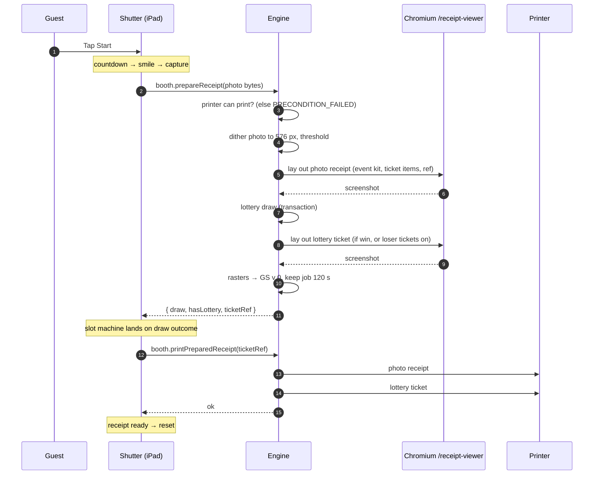

A visit is split into **prepare** and **print**. Preparing commits the lottery draw and renders both receipts while the guest watches the slot machine; printing happens once the reels stop. The guest never waits for a render after the animation, and the animation always shows the real outcome.

## Sequence

## The Experience state machine

The Shutter's guest flow is a reducer (`apps/shutter/src/app/Experience/internal/Experience.machine.tsx`) with explicit phases:

`idle → introExiting → promptEntering → countdown → smile → capturing → preparing → spinning → slotResult → instructions → printing → cameraExiting → receiptReady → resetting… → idle`

- **Lottery on or off.** The stage is laid out at capture, before the draw, so `startRequested` carries a first guess, `hasLottery`, from `booth.getLotteryStatus` (refetched at every `idle` and on `lottery-updated`; unknown counts as off). The engine has the last word: `prepareReceipt` returns `hasLottery`, true when the draw ran against a lottery (the event's while it is on, or a forced prize). `receiptPrepared` keeps `hasLottery` if either says so, so a prize is always revealed on the reels and reels already showing never vanish (they land on the loss). Without a lottery, `receiptPrepared` goes straight from `preparing` to `printing`, skipping `spinning`, `slotResult` and `instructions`: 8.7 s shorter (2.2 s of reels stopping, `SLOT_STAGE_ENTER_MS` 500 ms then three reels 400 ms apart taking 900 ms each, plus the 2.5 s result hold and the 4 s claim hold). The slot panel never mounts, the frozen photo stays full size in the live feed's square instead of shrinking to the left, and every caption sits inside that square. The draw captions (`prompts.feelingLucky`, `prompts.thatsIt`) are replaced by `prompts.printing`. If the engine's draw turns the lottery on, the photo shrinks to the left and the reels slide in at `spinning`, as on a normal lottery visit. The landing screen hides its lottery panel whenever the status isn't `enabled`.

- **Phase flags** (`Experience.phases.tsx`) declare what each phase shows and allows: camera visible, start enabled, print attempt running… The map is an exhaustive `Record<ExperiencePhase, …>`, so a new phase doesn't compile until its behaviour is decided.
- **Animation fallbacks.** Each animated transition has a timer fallback, so a missed `animationend` event can't freeze the flow.
- **Print attempts** carry an id. A late `printSucceeded` or `printFailed` from an earlier attempt is ignored.
- Kiosk commands (reload when idle, maintenance, open the Darkroom) wait for `idle`, so a visit is never cut off. They apply after 90 s anyway, because a stuck flow never gets back to idle.

## Prepare: `booth.prepareReceipt`

The photo is sent as raw bytes (`octetInputParser`), not JSON.

1. **Printer gate.** `assertPrinterAvailable` refuses with `PRECONDITION_FAILED` if the printer can't print — **before the draw**, so a booth out of paper never burns a prize. With automatic maintenance off, only a disconnected printer is refused.
2. **Dither.** The photo is rotated, resized to the printer's **576 dots** (80 mm at 203 dpi) and dithered with the booth's print configuration (see [Print settings](/docs/reference/print-settings/)), then thresholded to pure black/white.
3. **Lay out.** The headless Chromium page, which stays open on the Shutter's `/receipt-viewer`, renders the event's **kit** with the dithered photo, the ticket items and the ticket ref, and the engine screenshots it. One page serves every job, one at a time (`runExclusiveReceiptViewerPageJob`); the screenshot is capped at 12 s.
4. **Draw.** `executeLotteryDraw` runs inside one SQLite transaction: cooldown read, weighted pick among prizes with stock, insert of the `draw` row (which is what takes the unit of stock). A ticket-ref collision retries with a new ref, and the photo receipt is re-rendered with the ref that was actually recorded.
5. **Lottery ticket.** Rendered for a win, or for a loss when the lottery prints loser tickets.
6. **Raster.** Each screenshot becomes an ESC/POS `GS v 0` raster command. With `print_config.upside_down` on (the default), the 1-bit image is turned 180° before packing: the printer feeds the top of the ticket out first, so turned, it reads the right way up for the guest holding it. Doing it in the image rather than with the printer's `ESC {` keeps it independent of how the printer treats raster graphics in upside-down mode, and before the real-time byte escape, which has to see the final bytes.
7. **Store.** The job is kept in memory for **120 s**, keyed by ticket ref, and the draw is returned to the iPad with `hasLottery`, whether it ran against a lottery.

## Print: `booth.printPreparedReceipt`

1. The printer gate runs again.
2. The job is **taken out** of the store while printing, so a double submit can't print twice.
3. The photo receipt prints, and the job remembers it did (`photoPrinted`). Then the lottery ticket.
4. On failure the job is **put back**. The iPad retries up to **2 times, 2 s apart**, and a retry prints only what didn't come out: never a second photo.
5. The whole printing phase has a **45 s** budget on the iPad. Past it, or after the retries, the visit resets.

A `NOT_FOUND` (job expired after 120 s, or never prepared) isn't retried.

## Print jobs on the wire

All jobs go through one long-lived USB connection, serialised (`runExclusivePrinterJob`). A job is:

1. `DLE DC4 fn 8` — clear buffers, **only after a job was aborted**, since the printer may still be waiting for the rest of a cut-off raster.
2. `ESC @` — initialise.
3. `GS a 0xFF` — re-enable Automatic Status Back, which `ESC @` turned off.
4. `ESC a 1` centre, the `GS v 0` raster, line feeds, `GS V` cut.

If the printer reports it can't print while a job is being written, the job is aborted within about a second with `PRINTER_UNAVAILABLE`. A job the printer doesn't take within 20 s is abandoned as stalled. Details in [Printer and printer watch](/docs/architecture/printer/).

## Test prints and dry run

- **Test prints** (`config.printReceipt`, from the Darkroom) use the same render path with the sample ref `000000` and **never draw**.
- **Sample lottery tickets** (`config.printSampleLotteryTicket`, from the Darkroom and admin's **Settings → Printing**) render a win for a chosen prize, or a loss, under the same ref, without touching the lottery.
- **`RECEIPT_PRINT_DRY_RUN=true`** (development only) puts the preview printer in place of the USB one. Visits, test prints and sample lottery tickets take the same path, and the printer saves each raster as a PNG in `tmp/receipt-previews/` and opens it instead of printing. See [Developing without a printer](/docs/development/without-a-printer/).
