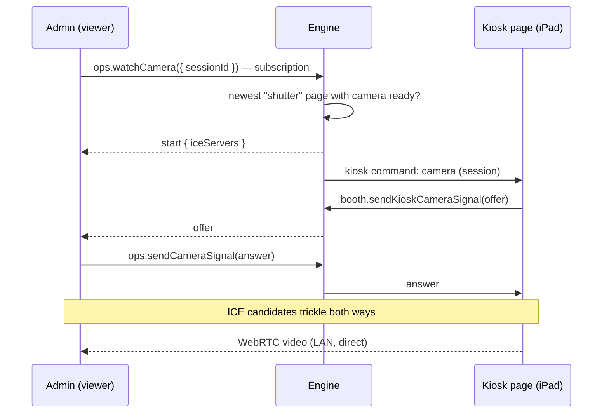

The engine can push commands to the kiosk pages on the iPad without anyone touching it. Pages report back their state. The same channel signals the WebRTC live view of the booth camera.

Code: `apps/engine/src/domains/kiosk/`, schemas in `@dither-booth/shared/kiosk` and `@dither-booth/shared/camera-preview`.

## The stream

`booth.onKioskCommand({ pageId, deviceId, screen })` is a tRPC **subscription over server-sent events**, through the Shutter's `/engine/trpc` proxy. Only two routes subscribe:

- the Experience (`/`, `screen: "shutter"`),
- the Darkroom (`/darkroom`, `screen: "darkroom"`).

The `/receipt-viewer` page Chromium prints from never subscribes, so a reload never hits it. A page moving between the two screens ends one subscription and starts the other; `ops.getHealthz` → `shutter.kiosk.pages` always says which screen each page shows.

**Keep-alive.** Bun.serve closes a connection after 10 s without traffic. The engine pings every **5 s**; the client reconnects after **15 s** of silence. The proxy forwards the browser's abort signal, so a closed page ends its engine stream.

**Never replayed.** The channel is in memory, one per engine process. A command reaches the pages connected **when it's sent**; a page that was offline misses it, and the `delivered` count says so. That's deliberate: a page must not reload in a loop when it reconnects later. State a page needs on connecting (maintenance, the engine's release) is the stream's **opening messages** instead.

## Commands

Commands are the `KIOSK_COMMAND_SCHEMA` union. A new command is a new `type`.

| Command                   | Sent by                                                                                                                            | Behaviour                                                                                                                                                                                                                                                                                                                                                                                                                                                                                                                                                                              |
| ------------------------- | ---------------------------------------------------------------------------------------------------------------------------------- | -------------------------------------------------------------------------------------------------------------------------------------------------------------------------------------------------------------------------------------------------------------------------------------------------------------------------------------------------------------------------------------------------------------------------------------------------------------------------------------------------------------------------------------------------------------------------------------- |
| `reload { mode }`         | `ops.reloadKiosk`                                                                                                                  | `when-idle`: once the Experience is back on the landing screen, or after 90 s anyway. `now`: at once. The Darkroom reloads at once in both modes.                                                                                                                                                                                                                                                                                                                                                                                                                                      |
| `navigate { screen }`     | `ops.showKioskScreen`                                                                                                              | `darkroom`: opens the Darkroom's **PIN screen** once idle (90 s max); the command carries no session. `shutter`: locks the Darkroom and returns to the landing screen at once, so an unattended kiosk is never left unlocked.                                                                                                                                                                                                                                                                                                                                                          |
| `release { release }`     | the engine, as each stream opens                                                                                                   | State: every stream opens with the release the engine runs, after the maintenance state. The page knows the release its own code came with: it asks its server's `/healthz` once when the code loads (an older server, or no answer, leaves the first stream's release as the fallback). A stream that opens with another one means the engine was updated under the page, whether the page was connected at the time or reconnected after: the page handles it as `reload { mode: "when-idle" }`, so the Experience reloads once back on the landing screen and the Darkroom at once. |
| `maintenance { enabled }` | `ops.setKioskMaintenance`, the printer policy                                                                                      | State, not an event: every stream opens with the current value. The Experience shows “be right back” once idle (90 s max) and hides it at once. The Darkroom ignores it.                                                                                                                                                                                                                                                                                                                                                                                                               |
| `kit-updated`             | `config.updateKitSettings`, `config.createEvent`, `config.replaceEvent`                                                            | The Experience re-reads `booth.getKit`. New copy can show mid-visit: it changes words, never the flow.                                                                                                                                                                                                                                                                                                                                                                                                                                                                                 |
| `lottery-updated`         | `config.updateLotterySettings`, `config.createEvent`, `config.replaceEvent`, the prize mutations (create, update, delete, restock) | The Experience re-reads `booth.getLotteryStatus`, so the landing screen shows or hides its lottery panel at once. A visit under way is settled by its own draw (see [A guest visit](/docs/architecture/guest-visit/#the-experience-state-machine)).                                                                                                                                                                                                                                                                                                                                    |
| `camera …`                | `ops.watchCamera`                                                                                                                  | Starts the live-view session on the page (below).                                                                                                                                                                                                                                                                                                                                                                                                                                                                                                                                      |

Every `ops.*` command returns `{ delivered }`, the number of pages that got it. `kit-updated` and `lottery-updated` are sent only once the `config.*` save succeeded, by the event procedures in `apps/engine/src/domains/event/internal/event.kiosk.ts`, and missing one costs nothing: the page reads the kit and the lottery status fresh when it loads, and the lottery status again every time the Experience is back on the landing screen.

## Status back

`booth.reportKioskStatus({ pageId, camera, maintenance })`: a page reports its camera state (or `null` while it runs none, as on the Darkroom's PIN screen) and whether it shows the maintenance screen yet, on every change and every reconnection, then every 30 s (`KIOSK_STATUS_REPORT_INTERVAL_MS`) as proof it is still there: an iPad switched off, asleep or off the Wi-Fi closes nothing, so its stream stays open on the engine's side until TCP gives up, many minutes later. The engine stores each report on the page's entry (`reportedAt`) until its stream ends, and answers `{ registered: false }` for a page it doesn't know (the page retries). Admin's **Camera** health item reads it; a failed camera is unhealthy. The [heartbeat](/docs/development/hub/#how-a-registered-booth-reports) reads it too, as one flag: the booth has its camera while a page has reported within 90 s and no page's camera failed, and the Hub's **Camera off** alert fires once it hasn't for two minutes during the booth's event times or an event.

## The camera on the page

`useUserMedia` (`packages/ui/src/hooks/user-media/`) runs the camera for the `Webcam` component, on the Experience and the Darkroom's print tuning. Its state is what `reportKioskStatus` carries.

- **`ready` means a picture.** The state flips to `ready` on the first frame, not when `getUserMedia` resolves. The hook listens for `requestVideoFrameCallback` and `timeupdate` together and takes whichever comes first: a browser may not run frame callbacks for a video it doesn't draw, and the Shutter hides its live feed (`display: none` in the Darkroom once a preview shows, `visibility: hidden` in the Experience behind the frozen photo), while `timeupdate` follows playback. A browser can open the camera and draw nothing, with a live track and no error: seen on a page reloaded while its camera was running. Every photo then failed (`platform error`, `setPhotoOptions failed`) while admin showed the camera healthy. An `unmute` gives `ready` back only to a camera that has shown a picture.
- **No picture within 5 s, or the track ends:** the state is `error` (“The camera gives no picture.” / “The camera stopped.”), the stream is closed and the camera reopened after 1.5 s. Three restarts in a row at most. A picture gives them back only once it has lasted 30 s, so a camera that draws a frame and dies right after still runs out. Once they have run out, the message gains “Close the browser fully and open the Shutter again.” and stays, so the Camera health item and the Booth camera card show it. A reload is not enough: the browser's camera can stay hung across reloads.
- **No visit without a picture.** The Experience's **Start** stays disabled until the page's camera is `ready` (`useExperienceFlow`, from the kiosk camera store), as it does during maintenance. A guest can't start a visit that would end in a failed print.
- **A photo is a frame when `takePhoto` fails.** `ImageCapture.takePhoto` can break while the video runs (virtual cameras, a phone used as a camera). The hook then waits up to 1 s for a fresh frame, draws it to a canvas and returns that JPEG, logging `photo-capture-fallback` (warn). A stalled picture is never printed: without a fresh frame, the original error is thrown.

## Camera live view

The engine only relays **signalling**. Video goes peer-to-peer from the iPad to the viewer on the LAN.

- The subscription **is** the session. Ending it (Stop, tab closed) sends the page `end viewer-left`; the page leaving sends the viewer `end page-left`.
- It ends with a single `end` instead of `start` when there is no camera (`no-camera`) or two viewers already (`busy`).
- A session stops after **10 minutes** (`timeout`), to spare the iPad.
- Only the session's page is heard on `sendKioskCameraSignal`.
- `CAMERA_PREVIEW_ICE_SERVERS` is empty: on the LAN, host candidates connect directly. A TURN relay would be added there for viewing from outside the LAN, and both sides would get it in `start`.

## Limits

- A tab whose JavaScript is fully frozen can't react to anything; it needs a manual reload on the iPad.
- One engine process, one channel: there's no fan-out across processes, and none is needed.
