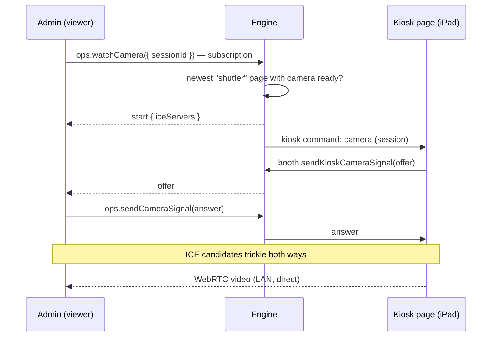

The engine can push commands to the kiosk pages on the iPad without anyone touching it. Pages report back their state. The same channel signals the WebRTC live view of the booth camera.

Code: `apps/engine/src/domains/kiosk/`, schemas in `@dither-booth/shared/kiosk` and `@dither-booth/shared/camera-preview`.

## The stream

`booth.onKioskCommand({ pageId, deviceId, screen })` is a tRPC **subscription over server-sent events**, through the Shutter's `/engine/trpc` proxy. Only two routes subscribe:

- the Experience (`/`, `screen: "shutter"`),
- the Darkroom (`/darkroom`, `screen: "darkroom"`).

The `/receipt-viewer` page Chromium prints from never subscribes, so a reload never hits it. A page moving between the two screens ends one subscription and starts the other; `ops.getHealthz` → `shutter.kiosk.pages` always says which screen each page shows.

**Keep-alive.** Bun.serve closes a connection after 10 s without traffic. The engine pings every **5 s**; the client reconnects after **15 s** of silence. The proxy forwards the browser's abort signal, so a closed page ends its engine stream.

**Never replayed.** The channel is in memory, one per engine process. A command reaches the pages connected **when it's sent**; a page that was offline misses it, and the `delivered` count says so. That's deliberate: a page must not reload in a loop when it reconnects later. State a page needs on connecting (maintenance) is the stream's **opening message** instead.

## Commands

Commands are the `KIOSK_COMMAND_SCHEMA` union. A new command is a new `type`.

| Command                   | Sent by                                       | Behaviour                                                                                                                                                                                                                     |
| ------------------------- | --------------------------------------------- | ----------------------------------------------------------------------------------------------------------------------------------------------------------------------------------------------------------------------------- |
| `reload { mode }`         | `ops.reloadKiosk`                             | `when-idle`: once the Experience is back on the landing screen, or after 90 s anyway. `now`: at once. The Darkroom reloads at once in both modes.                                                                             |
| `navigate { screen }`     | `ops.showKioskScreen`                         | `darkroom`: opens the Darkroom's **PIN screen** once idle (90 s max); the command carries no session. `shutter`: locks the Darkroom and returns to the landing screen at once, so an unattended kiosk is never left unlocked. |
| `maintenance { enabled }` | `ops.setKioskMaintenance`, the printer policy | State, not an event: every stream opens with the current value. The Experience shows “be right back” once idle (90 s max) and hides it at once. The Darkroom ignores it.                                                      |
| `camera …`                | `ops.watchCamera`                             | Starts the live-view session on the page (below).                                                                                                                                                                             |

Every `ops.*` command returns `{ delivered }`, the number of pages that got it.

## Status back

`booth.reportKioskStatus({ pageId, camera, maintenance })`: a page reports its camera state (or `null` while it runs none, as on the Darkroom's PIN screen) and whether it shows the maintenance screen yet, on every change and every reconnection. The engine stores it on the page's entry until its stream ends, and answers `{ registered: false }` for a page it doesn't know (the page retries). Admin's **Camera** health item reads it; a failed camera is unhealthy.

## Camera live view

The engine only relays **signalling**. Video goes peer-to-peer from the iPad to the viewer on the LAN.

- The subscription **is** the session. Ending it (Stop, tab closed) sends the page `end viewer-left`; the page leaving sends the viewer `end page-left`.
- It ends with a single `end` instead of `start` when there is no camera (`no-camera`) or two viewers already (`busy`).
- A session stops after **10 minutes** (`timeout`), to spare the iPad.
- Only the session's page is heard on `sendKioskCameraSignal`.
- `CAMERA_PREVIEW_ICE_SERVERS` is empty: on the LAN, host candidates connect directly. A TURN relay would be added there for viewing from outside the LAN, and both sides would get it in `start`.

## Limits

- A tab whose JavaScript is fully frozen can't react to anything; it needs a manual reload on the iPad.
- One engine process, one channel: there's no fan-out across processes, and none is needed.
