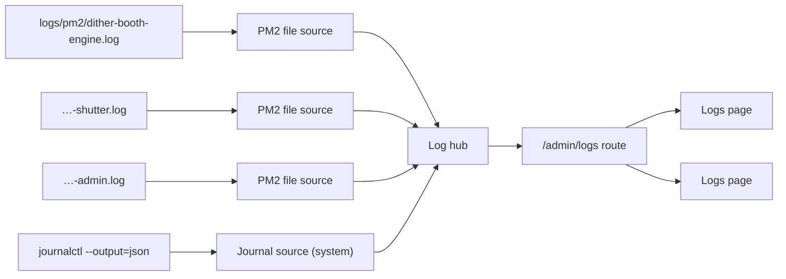

The apps write one JSON line per event, PM2 keeps one combined file per process, and logrotate rotates the files ([Logs](/docs/maintenance/logs/), [ADR 0006](/docs/decisions/0006-json-line-logs/)). The **admin server** reads those files, and the system journal, and streams them to the admin's Logs page. It is the admin, not the engine, because the engine is the process most likely to be down when someone needs its logs.

Code: `apps/admin/src/lib/logs/` for the server, `apps/admin/src/app/Logs/` for the page. The socket tests in `logs.routes.test.tsx` drive the route with a fake socket, a temp folder of PM2 files and a fake source; `logs.journal.test.tsx` drives it with a fake `journalctl`. The page's render tests in `Logs.render.test.tsx` drive the page with a fake socket in place of `WebSocket` (`Logs.testing.tsx`).

## The pieces



| Piece           | File                | Job                                                                                      |
| --------------- | ------------------- | ---------------------------------------------------------------------------------------- |
| Protocol        | `logs.protocol.tsx` | zod schemas for every message and for a log entry. The page validates with the same ones |
| Filter          | `logs.utils.tsx`    | `matchesLogFilter`: one predicate for history on the server and live lines on the page   |
| Log source      | `logs.types.tsx`    | The `LogSource` interface every source implements                                        |
| PM2 file source | `logs.pm2.tsx`      | Follows and pages one PM2 combined file                                                  |
| Journal source  | `logs.journal.tsx`  | Follows and pages the system journal through `journalctl`, as the `system` service       |
| Log hub         | `logs.hub.tsx`      | One follower per source for every open page; merges sources by time; batches live lines  |
| Route           | `logs.routes.tsx`   | The socket: validates requests, tracks each page's cursor, holds live lines while needed |

Protocol, filter, types and constants have no server-only imports, so the page imports them. The admin server builds the hub, with its four sources, in `server-app.ts`.

**Names live in `@dither-booth/shared/booth-system`.** The PM2 process names (`PM2_PROCESS_NAMES`), the log folder (`logs/pm2`) and the journal's booth units (`ditherbooth.service`, `ditherbooth-network.service`) are defined there, and the admin and the CLI import them. `pm2.config.js` repeats the process names and the folder, because PM2 loads it without the workspace; `booth-system.test.ts` fails if the two differ. The kiosk line itself (its `[kiosk]` prefix, its JSON shape and the `server-started` event) is defined once in `@dither-booth/logging/kiosk-line`, which the logger writes with and the admin reads with.

## The socket

`wss://<booth>:3002/admin/logs`. The upgrade is origin-checked like every admin socket ([Access control → Logs socket](/docs/architecture/access-control/#logs-socket)). It is mounted whether or not the admin runs under PM2: without the files, each source just reports itself unavailable.

**The page sends** one kind of message:

```json
{
  "type": "history",
  "filter": { "services": ["engine"], "levels": ["error"] },
  "limit": 200
}
```

- no cursor: the latest page;
- `before: <cursor>`: the page just older than the cursor (scrolling up);
- `after: <cursor>`: the page just newer than it (resuming after a reconnect).

`limit` is 1 to 1000. Anything that fails validation (bad JSON, an unknown level or service, a limit over 1000, both cursors, a cursor the server can't read) gets an `error` message and the socket is closed with **1008**.

**The server sends:**

| Message         | Fields                        | When                                                                                              |
| --------------- | ----------------------------- | ------------------------------------------------------------------------------------------------- |
| `history`       | `entries`, `cursor`, `done`   | Answer to each request. Entries oldest first, **filtered on the booth**                           |
| `append`        | `entries`, `cursor`           | New lines from every service, **unfiltered**, merged by time, at most every **200 ms**            |
| `source-status` | `service`, `state`, `message` | For every source on the first request, then on each change: `available`, `unavailable`, `rotated` |
| `error`         | `message`                     | Before the server closes the socket                                                               |

`done` on a `before` page means nothing older is left; on an `after` page it means the page has caught up and live lines follow.

**The cursor** is opaque to the page: keep the last one received, from any `history` or `append`, and send it back. Inside, it holds two positions per source: where the page's history reaches back to, and how far its live lines reach. So the same cursor works for scrolling up and for resuming.

## Entries

An entry is `{id, timestamp, service, stream, level, source?, event?, details?, error?, raw, origin, deviceId?, runId?}`.

- **Services** are `engine`, `shutter`, `admin` and `system`. Browser is an **origin**: a [browser report](/docs/start-here/glossary/#logs) is an entry of the server that wrote it, with `origin: "browser"`. The filter's service list has a sixth value, `browser`, for those lines. The page shows them as **Browser** plus the first 6 characters of `deviceId`, and names the receiving server (`service`) as **Received by** in the details.
- **From a PM2 line.** The envelope's `message` is split on newlines; each non-blank line is one entry, except crash output: an indented line, or the line after one of Bun's code-frame lines (`12 | code`) or its caret, joins the plain-text line before it, so a stack trace and the code frame above it stay one entry. A `[kiosk]` line becomes a structured entry, timed by its `loggedAt`. Anything else is plain text, timed by the envelope's `timestamp`: on `err` it is an `error`, on `out` an `info`. A line that isn't an envelope at all is kept as plain text.
- **A line PM2 split across chunks** is joined back. PM2 writes one envelope per chunk it reads from the pipe, so a long line can end one envelope (its `message` has no final newline) and go on in the next. A _record_ is an envelope plus the envelopes that continue it: next in the file, same `type`, and either the one before doesn't end in a newline, or it ends in plain text and the next starts with crash output by the rule above (PM2 can cut a stack trace between two of its lines). Its messages are joined, then split into entries. Live, history and resume reads cut the same records, both directions.
  - At most **8** envelopes are joined. A longer run (endless output with no newline) isn't joined at all, so both directions still agree.
  - An envelope of the other stream in between ends the record: the two halves show as plain text.
  - **Live**, a record at the end of the file that may go on (cut mid-line, or ending in plain text) waits up to **1 s** (by its envelope's `timestamp`) for the next chunk, then goes out as it is. So plain-text lines show up to 1 s late; kiosk events don't wait. A source that starts right after a cut starts before that record, to read it whole.
- **The id** is `<service>:<generation>:<byte offset of the record>:<index>`, stable however the line is read.
- **Lines over 64 KB** are cut to 64 KB.
- **From the journal**, see [The system journal](#the-system-journal).

## Following a file

Each PM2 file source:

- starts at the **end of the last complete line**: older lines are history, read on request;
- re-reads on every file-change event of `logs/pm2/` and every **1 s** anyway, because change events aren't reliable everywhere;
- reads only complete lines, so a line being written is picked up whole on the next read;
- hands the hub new lines in batches of at most 500.

**Rotation.** logrotate copies then truncates in place. A source counts the file as rotated when it is **smaller than the position read so far**, or when its **first line changed** (its _generation_, a hash of the first line, caught when the file was truncated and refilled between two reads). It then sends `rotated`, starts again at byte 0, and reports `available`.

**Missing file.** A missing file is `unavailable` with "No log file at logs/pm2/<process>.log. Is it running under PM2?". When it appears, the source reads it from the start and reports `available`.

## History pages

A position in a file is `<generation>:<byte offset of a record>:<entry index in that record>`, so a page can end in the middle of a multi-line chunk, but never inside a record.

- **Older pages** are read backward from the position in **64 KB** chunks, keeping only entries that match the filter, until the page is full or the file starts. Filtered history scans as far back as it must, so "all errors today" works however far back they are. Memory stays bounded: one chunk, one line and the matches.
- **Merging.** Each source returns its newest `limit` matches; the hub merges them by timestamp (each source's own order kept) and keeps the newest `limit`. Each source's next position is its oldest kept entry, so nothing is skipped or repeated.
- **Rotated files aren't searched.** A `before` position from an older generation, or past the end of the file, gives an empty, done page.

## Fan-out and memory

One hub serves every open page, with **one follower per source**. Sources start with the first page's first request and stop when the last page closes, so a booth with no Logs page open reads nothing.

The admin is restarted by PM2 above **256 MB**, so everything is bounded:

| What                                  | Bound                                                                       |
| ------------------------------------- | --------------------------------------------------------------------------- |
| Live lines waiting for the next batch | Sent early once **1000** are waiting                                        |
| Live lines held for one page (below)  | **5000**; past that the socket is closed with **1013** and the page reloads |
| One history page                      | **1000** entries                                                            |
| A read                                | **64 KB** chunks, **64 KB** lines                                           |
| `journalctl` processes                | One follower, plus one per history request being served                     |

## Resume without gaps or repeats

Every page's live lines start where its first request found the hub: everything before is history, everything after arrives as `append`.

Sources start together. A line a source sends while another is still starting is kept, not dropped: that source's history ends just before it, and it goes out as `append` once every source has started.

- **While a history request is served**, the page's live lines and status changes are **held**, then sent right after the page. A page never gets live lines it would also find in the page it is waiting for.
- **After a reconnect**, the page sends `after: <last cursor>` on the new socket. The server reads from there up to where this socket's live lines start, one page at a time, holding live lines until a page says `done`. The page ends up with every line once, in order.
- If a file was rotated since the cursor, the server sends `rotated` for it and reads the new file from the start: the lines written between the cursor and the rotation may be missing, and the page can say so.

## The page

Admin's Logs page (`/logs`, `apps/admin/src/app/Logs/`) is the socket's only client. How staff use it: [Logs → Open Logs](/docs/maintenance/logs/#open-logs).

**The filter is the URL.** The route validates four search params with zod (`lib/logs/logs.search.tsx`): `services` and `levels` as comma lists, `source`, and `q` for the text. Unknown values are dropped, and a list naming every value is the same as none, so links stay short: `/logs?source=engine.printer&levels=error,warn`. Health items link here with presets (`HEALTH_LOGS_SEARCH` in `HealthCard.constants.tsx`).

**One socket, one timeline.** `useLogStream` opens the socket and asks for the latest **500** lines with the filter. Live lines arrive unfiltered; the page keeps them all and shows those that pass `matchesLogFilter`, the same predicate the server used for the history. A filter change throws the timeline away and asks again on the same socket: history was filtered for the old filter. Answers to requests sent before the change are dropped. Entries are deduplicated by id, so a live line that also lands in the page it raced is shown once.

**Bounded memory.** At most **10,000** lines, the oldest dropped first. Once lines have been dropped, or an older page would pass the cap, the list stops loading older lines and says so at the top: narrow the filter to read further back.

**The list** is `react-virtuoso` (MIT), only the visible rows in the DOM:

| Behaviour              | How                                                                                                                                                                                                   |
| ---------------------- | ----------------------------------------------------------------------------------------------------------------------------------------------------------------------------------------------------- |
| Follow while at bottom | `followOutput` scrolls to new lines when the list was within **48 px** of the bottom, and no line is open                                                                                             |
| “N new lines” pill     | Off the bottom for **300 ms** counts as scrolled up (new lines push the list off for a frame before it follows). The pill counts visible lines added since; it and **End** scroll to the last line    |
| Older lines at the top | `startReached` sends `before: <last cursor>`. `firstItemIndex` starts at 1,000,000 and drops by the visible lines prepended, so the reader's line doesn't move                                        |
| Restart divider        | A server's `server-started` event is drawn as a divider instead of a line. `matchesLogFilter` lets it through the level, source and text filters (not the services), on the server and the page alike |
| Rotation divider       | Drawn when a `rotated` status arrives                                                                                                                                                                 |

**Pause** keeps the socket and the cursor; new lines wait in a buffer (also capped at 10,000) and the badge counts them. While paused, a polite live region announces “N new errors”. The list itself is `role="log"` with `aria-live="off"`, so a screen reader isn't read every line.

**Reconnecting.** When the socket closes, the page draws a “Connection lost” divider and retries after **1 s**, doubling to at most **10 s**; the browser's `online` event retries at once. The badge says **Reconnecting**, then **Offline** after **3** failed attempts in a row or while the browser is offline, with a **Retry now** banner. On the new socket it sends `after: <last cursor>` and keeps asking until a page is `done`, then marks the divider “Reconnected · no lines missed”, or “some lines may be missing” if a source rotated in between. A cursor the server refuses (**1008** while resuming) falls back to the latest page, marked as a possible gap. A **1008** on a fresh request is not retried: the banner offers **Retry now**. A **1013** (fell behind) waits out the same backoff, then loads the latest page instead of resuming, marked as a possible gap: catching up again could fall behind again.

## The system journal

The `system` service is the journal source (`logs.journal.tsx`). It runs `journalctl --output=json --no-pager` with an args array, never a shell, and reads only these entries:

```text
_SYSTEMD_UNIT=ditherbooth.service _SYSTEMD_UNIT=ditherbooth-network.service _SYSTEMD_UNIT=NetworkManager.service
+ UNIT=ditherbooth.service UNIT=ditherbooth-network.service UNIT=NetworkManager.service
+ _TRANSPORT=kernel
```

Values of one field are alternatives, and `+` ORs the three groups: the units' own output, systemd's messages about them (started, exited, restarted), and the kernel. `--unit` can't be used: journalctl ANDs it with the kernel match. Everything else in the journal stays on the booth.

**Mapping.** One JSON line is one entry, `stream: "journal"`:

| Entry       | From the journal                                                                                                                     |
| ----------- | ------------------------------------------------------------------------------------------------------------------------------------ |
| `level`     | `PRIORITY` 0–3 → `error`, 4 → `warn`, anything else or none → `info`                                                                 |
| `source`    | `kernel` for `_TRANSPORT=kernel`, else `UNIT`, else `_SYSTEMD_UNIT` (e.g. `NetworkManager.service`)                                  |
| `timestamp` | `__REALTIME_TIMESTAMP`, to the millisecond                                                                                           |
| `raw`       | `MESSAGE`. Byte arrays (non-UTF-8 text) are decoded; a field over 4096 bytes, which journalctl prints as `null`, shows a placeholder |
| `details`   | `identifier` (`SYSLOG_IDENTIFIER`) and `pid` (`_PID`), when present                                                                  |
| `id`        | `system:<__CURSOR>`                                                                                                                  |

Journal lines aren't [kiosk] events: they have no `event` and nothing in them is redacted.

**Following.** On start, `journalctl --reverse --lines=1` finds the newest matching entry: everything up to it is history. Then one `journalctl --follow --lines=all --after-cursor=<its cursor>` streams the rest (`--lines=all`, or journalctl would hold back all but 10 of a backlog until the next new entry). If that process exits, the source reports `unavailable` ("journalctl stopped"), starts it again **5 s** later after the last entry it handed on, and reports `available`: no line is lost. Stopping the source kills every `journalctl` it started.

**Positions** are `a:<realtime µs>:<cursor>` (just after that entry), `b:<realtime µs>:<cursor>` (just before it), or `head` (an empty journal). Cursors are checked against journald's format before they reach an argument.

**History.** Each page is one short-lived `journalctl`, killed once the page is full:

- older: `--reverse --cursor=<c>` (from `a:`, the entry included) or `--reverse --after-cursor=<c>` (from `b:`);
- newer: `--after-cursor=<c>` or `--cursor=<c>`, bounded by `--until=@<seconds>` (rounded up) and stopped exactly at the `until` entry's cursor.

The filter runs on the admin, so a page of rare matches reads as far back as the journal goes. journald's own size limits bound that; there is no rotation to detect.

**Unavailable.** Without `journalctl` (macOS, a dev machine), the source is `unavailable` with "No journalctl on this machine" and pages are empty. When journalctl warns that the user can't see the system journal (`pi` not in `systemd-journal`), it is `unavailable` with what to run. Neither breaks the socket.

## Writing a source

A source implements `LogSource` (`logs.types.tsx`):

- `start(listener)` / `stop()`: follow new lines, hand them to `listener.onEntries(entries, position)`, report changes with `listener.onStatus`;
- `getLivePosition()`, `getStatus()`;
- `readBefore({before, limit, matches})` and `readAfter({after, until, limit, matches})`: matching entries with the positions just before and after each.

Positions are strings only the source reads: byte offsets for a PM2 file, journal cursors for journald. The hub merges any number of sources. `logs.testing.tsx` has an in-memory fake source and a fake `journalctl` for tests.
