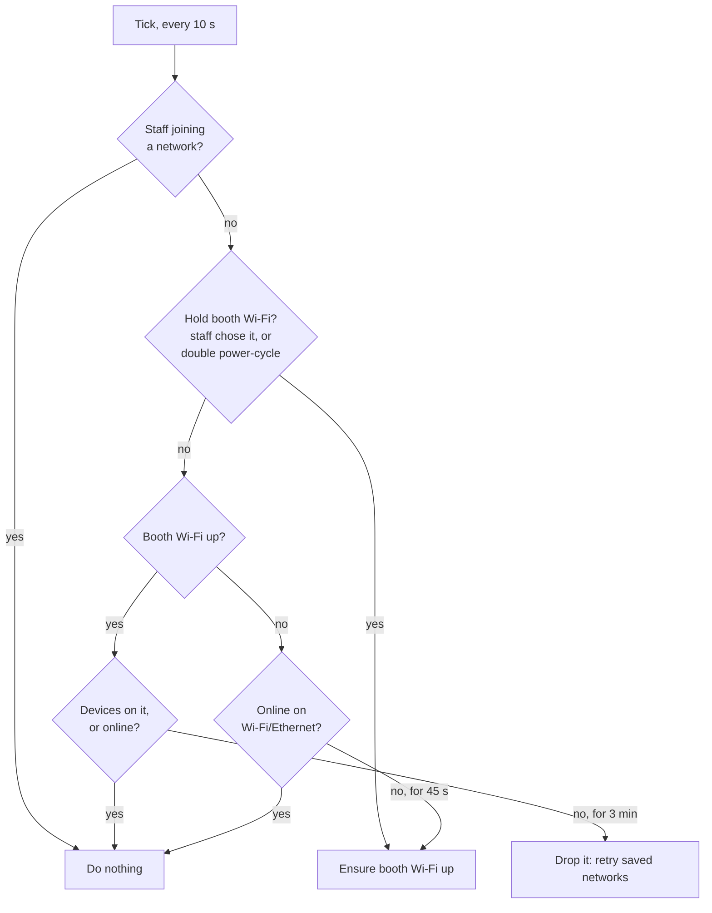

The booth must always end up on a network the iPad can reach, with no screen and no keyboard. **NetworkManager** owns the networks. Two actors drive it:

- the **engine**, as the service user, for what staff ask (save, forget, join, run on the booth Wi-Fi), allowed by a narrow polkit rule;
- the **network watch** (`booth network watch`, root, `ditherbooth-network.service`), for the fallback: open the booth Wi-Fi when nothing else is around, and keep the `.local` name.

They share state through files in `/var/lib/ditherbooth/` (owned by the service user), never through each other.

## The booth Wi-Fi

`booth network setup` creates a NetworkManager profile named `booth-hotspot`:

| Property    | Value                                                                                    |
| ----------- | ---------------------------------------------------------------------------------------- |
| SSID        | `DitherBooth-XXXX`, the last 4 hex digits of the Wi-Fi MAC                               |
| Security    | WPA-PSK, a random 10-character password without ambiguous characters (no `0/O`, `1/l/I`) |
| Band        | 2.4 GHz (`bg`)                                                                           |
| Address     | `10.42.0.1/24`, NetworkManager **shared** mode (DHCP and DNS by its dnsmasq)             |
| Autoconnect | off — only the watch or staff bring it up                                                |

The Pi has one radio. **AP mode takes it**, so the booth can't scan while its Wi-Fi is up. Just before opening it, the watch scans and saves what it saw to `wifi-scan.json`: that is the list the captive page and the Darkroom offer.

## The watch loop

Every 10 seconds, the watch reads `nmcli device`, decides, and acts. The decision is a pure function (`decideNetworkAction` in `apps/cli/src/internal/network-watch.ts`), unit-tested:

| Constant                | Value | Why                                                            |
| ----------------------- | ----- | -------------------------------------------------------------- |
| `OFFLINE_GRACE_MS`      | 45 s  | Long enough for NetworkManager to join a saved network at boot |
| `HOTSPOT_IDLE_RETRY_MS` | 3 min | A venue router that came up after the booth gets a chance      |
| Tick                    | 10 s  |                                                                |
| Early boot              | 120 s | A boot shorter than this arms the double power-cycle           |

**Double power-cycle.** At start, if the uptime is under 120 s, the watch checks for `early-boot`. Present: this boot follows one that lasted under two minutes, so it **forces** the booth Wi-Fi until staff join a network. Either way it writes the marker and deletes it once uptime passes 120 s.

**Staff choice.** `prefer-hotspot` exists while staff chose to run the event on the booth Wi-Fi (`config.setBoothWifi`). The watch holds the booth Wi-Fi for as long as it's there.

## Joining a network

`config.saveWifiNetwork({ ssid, password?, connectNow })` writes a NetworkManager profile with autoconnect on. With `connectNow`, the engine answers first and switches **1.5 s later**, so the reply reaches the device before the booth leaves the network it's on.

If the join fails, NetworkManager's error is mapped to staff words (“Wrong password.”, “Not in range.”, “The network gave the booth no address.”, “The network didn't accept the booth.”), the booth goes back to its Wi-Fi, and the engine prints a Wi-Fi ticket starting with the reason.

Inputs are validated: an SSID is at most 32 bytes, a WPA2 passphrase 8–63 characters.

## The captive page

Phones and laptops probe a known URL over plain HTTP when they join a Wi-Fi, to tell whether it needs a login page. On the booth Wi-Fi:

1. **DNS.** `/etc/NetworkManager/dnsmasq-shared.d/ditherbooth-captive.conf` resolves those probe hosts — and only those — to `10.42.0.1`. Apple (`captive.apple.com` and its legacy hosts), Android (`connectivitycheck.gstatic.com`…), Windows (`msftconnecttest.com`) and Firefox (`detectportal.firefox.com`). The rest of the internet still resolves, for a booth with an Ethernet uplink.
2. **Port 80.** Only root can open it, so the watch installs an nftables rule (table `ip ditherbooth`) that redirects `10.42.0.1:80` to the setup server on `:3003`. The rules go in through stdin, never a file the service user could edit.
3. **Answer.** The setup server (inside the Shutter process) asks the engine for the captive status:
   - `pick-network` — the booth opened its Wi-Fi for want of a network: answer the probe with a **302 to `/captive`**, the Wi-Fi picker. The device shows it on its own.
   - `booth-wifi-chosen` or not on the booth Wi-Fi: answer with the **expected success** body, so the device sees a normal network and shows nothing.
4. **Join.** The picker posts `{ ssid, password }` (JSON only, so another site can't post it without a preflight nothing answers) to the setup server, which calls `captive.joinFromCaptive` with its token. The engine refuses unless the state is `pick-network`: during an event on the booth Wi-Fi, a guest who joined it can't move the booth.

Only requests from the booth Wi-Fi's subnet (`10.42.0.0/24`, IPv4-mapped included) are treated as captive.

## The `.local` name

The certificate and tickets use `<hostname>.local`, answered by **avahi** (mDNS). After a network switch, avahi sometimes hears its own earlier announcement, decides the name is taken, and renames the booth `<hostname>-2`. The watch reads avahi's name over D-Bus (`busctl … GetHostName`) every tick and restarts `avahi-daemon` when it differs, at most every **5 minutes** so a real clash on the network can't loop.

The `.local` name also matters for **IPv6-only clients**. Some networks (an iPhone Personal Hotspot) give the iPad no IPv4 route to the booth; it reaches the booth only by name over IPv6. That's why the web servers bind `::`, and why tickets carry a second QR at `http://<hostname>.local:3003`.

## Address changes

A new LAN address needs a new certificate. The NetworkManager dispatcher hook `90-ditherbooth` runs on `up` and `dhcp4-change`, compares `hostname -I` with the address in `booth-manifest.json`, and `try-restart`s `ditherbooth.service` on a mismatch; the service's `ExecStartPre` re-issues the certificate. `10.42.0.1` is in every certificate, so moving to the booth Wi-Fi restarts nothing.

The engine checks every **5 s** for a new setup-ticket key — the boot id plus the network name and address, or `booth-wifi` — and prints a ticket when it changes, giving up on a key after 3 failed attempts. The last printed key is kept in `.local/device-setup/last-ticket`, so a PM2 restart doesn't reprint, while a power cycle (new boot id) does.

## Permissions

The polkit rule `/etc/polkit-1/rules.d/50-ditherbooth-network.rules` lets the service user, and nobody else, do exactly: modify system connections, network control, Wi-Fi scan, and Wi-Fi sharing. `booth doctor` (with sudo) warns if the installed rule differs from what the software expects.
