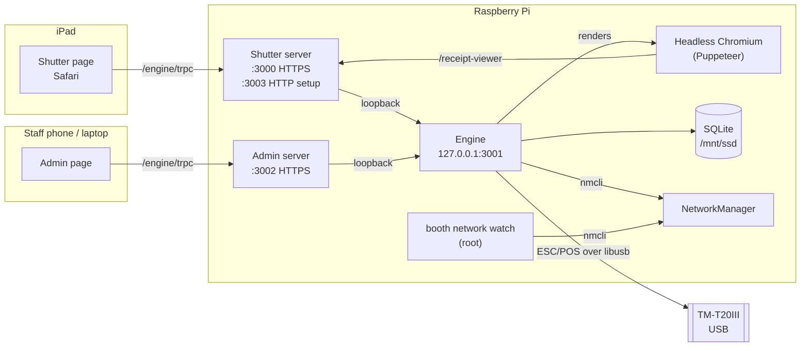

## Design principles

- **Offline first.** Everything an event needs runs on the Pi. No internet, no cloud call in the guest path. A booth on its own Wi-Fi in a field works.
- **No laptop on site.** The printer is the booth's first output: setup and Wi-Fi tickets carry what staff need to connect.
- **One owner per resource.** The engine is the only process that touches the database, the printer, NetworkManager (for the apps) and Chromium. The web servers proxy to it.
- **Fail visibly, never silently.** A printer that can't print closes the booth instead of eating receipts; health checks say what's wrong in staff words.

## Processes

| Process                | Runtime                            | Managed by                                 | Binds                           |
| ---------------------- | ---------------------------------- | ------------------------------------------ | ------------------------------- |
| `dither-booth-engine`  | Bun, `apps/engine/dist/server.js`  | PM2                                        | `127.0.0.1:3001`                |
| `dither-booth-shutter` | Bun, `apps/shutter/dist/server.js` | PM2                                        | `[::]:3000` HTTPS, `:3003` HTTP |
| `dither-booth-admin`   | Bun, `apps/admin/dist/server.js`   | PM2                                        | `[::]:3002` HTTPS               |
| PM2 daemon             | —                                  | `ditherbooth.service` (systemd, user `pi`) | —                               |
| `booth network watch`  | CLI binary                         | `ditherbooth-network.service` (root)       | —                               |
| Headless Chromium      | Chromium from apt (arm64)          | the engine                                 | —                               |

The two web servers bind `::` (IPv4 and IPv6) because some networks give the iPad no IPv4 route to the booth, only IPv6 via `<hostname>.local`.

## Request path

Browsers only ever talk to the **Shutter** and **Admin** origins. Each web server serves its single-page app and proxies `/engine/trpc` to the engine over loopback. The engine is never exposed on the network.

The admin server also serves this documentation at `/docs/`, straight from the static build in `apps/docs/dist` (`apps/admin/src/lib/docs/docs.routes.tsx`). The root `bun run build` builds it, so every booth carries the docs for the software it runs, readable with no internet.

The API is **tRPC** over HTTP, with subscriptions over **server-sent events** for the kiosk channel, the printer watch and the camera live view. The engine authorises each call by **origin** (admin vs. anywhere), a **Darkroom token**, or the **setup server token**; see [Access control](/docs/architecture/access-control/).

## Engine domains

The engine is organised by domain under `apps/engine/src/domains/`. Each has `queries/`, `mutations/` or `subscriptions/` (one tRPC procedure per file), an `index.ts` that exports them, a `*.service.ts` facade for other domains, and `internal/` for everything else.

| Domain                | Owns                                                                                  |
| --------------------- | ------------------------------------------------------------------------------------- |
| `receipt`             | Preparing and printing a visit's receipts, test prints, sample tickets                |
| `printer`             | The USB connection, Automatic Status Back parsing, print jobs, the maintenance policy |
| `image-manipulation`  | Dithering (blue noise and error-diffusion modes)                                      |
| `print-configuration` | The booth's print tuning (a singleton row)                                            |
| `event`               | Events, prizes, stock ledger, ticket items, draws listing                             |
| `lottery`             | The draw, cooldown, ticket refs, public lottery status                                |
| `kiosk`               | The kiosk command channel, maintenance state, camera live-view signalling             |
| `darkroom`            | PIN, tokens, lockout                                                                  |
| `device-setup`        | Setup links and the setup / Wi-Fi tickets, auto-printed                               |
| `network`             | Wi-Fi status, save/forget/join, booth Wi-Fi switch (via `nmcli`)                      |
| `captive`             | The captive page's two calls, reachable only by the setup server                      |
| `healthz`             | The Health card's checks                                                              |
| `browser-automation`  | Restarting the receipt Chromium                                                       |

## Startup order

1. systemd starts `ditherbooth.service` after `network-online.target` (and the SSD mount when the repo is on it).
2. `ExecStartPre`: `booth cert --if-changed` re-issues the leaf certificate if the LAN IP changed. A failure doesn't block the start.
3. `ExecStart`: `bun run pm2:start` launches PM2 with `pm2.config.js`: engine, admin, shutter.
4. The engine applies pending migrations, seeds the default print configuration, opens the printer, launches Chromium on `/receipt-viewer`, and starts the setup-ticket auto-print.

A NetworkManager dispatcher hook (`/etc/NetworkManager/dispatcher.d/90-ditherbooth`) restarts the service whenever the booth gets an address that doesn't match its certificate — except on the booth Wi-Fi, whose `10.42.0.1` is always in the certificate.

## Monorepo

| Path                      | What                                                                                                |
| ------------------------- | --------------------------------------------------------------------------------------------------- |
| `apps/engine`             | Backend                                                                                             |
| `apps/shutter`            | Guest app, Darkroom, receipt viewer, setup server                                                   |
| `apps/admin`              | Staff app                                                                                           |
| `apps/cli`                | `booth` provisioning CLI                                                                            |
| `apps/docs`               | This site                                                                                           |
| `packages/shared`         | Types, schemas and helpers shared across apps, split by runtime (`isomorphic`, `browser`, `server`) |
| `packages/ports`          | Ports, bind hosts, origins, TLS manifest                                                            |
| `packages/browser-server` | The Bun HTTPS server both web apps are built on                                                     |
| `packages/logging`        | Structured logging                                                                                  |
| `packages/ui`             | Shared React components                                                                             |

See [Repository and packages](/docs/development/repository/).
