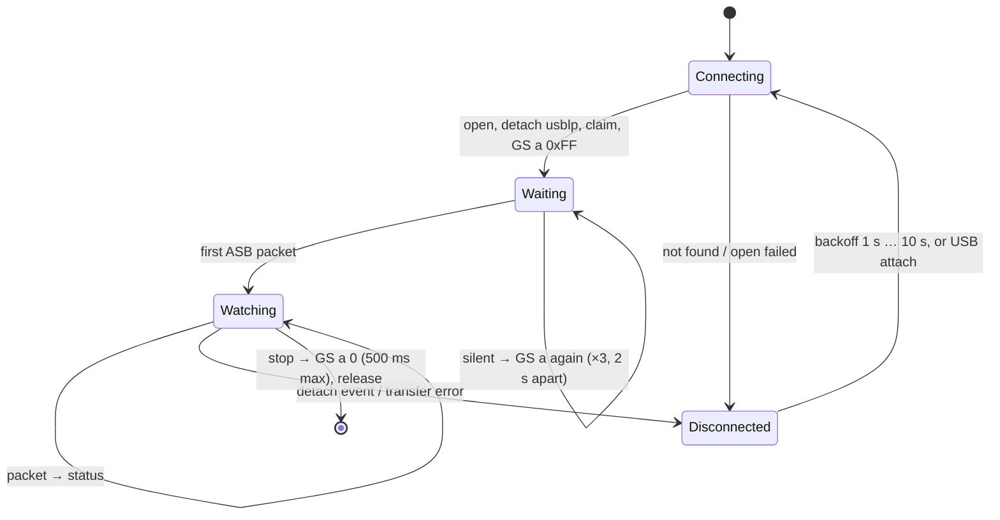

The engine holds **one libusb connection** to the printer for as long as it runs. It keeps **Automatic Status Back (ASB)** on, reads the IN endpoint in a loop, writes print jobs through the same handle, and reconnects on its own. Why this design: [ADR 0001](/docs/decisions/0001-persistent-printer-connection/). The measurements behind it: [Printer watch spec](/docs/specs/printer-watchdog/).

Code: `apps/engine/src/domains/printer/`.

## The device

|             |                                                                                                      |
| ----------- | ---------------------------------------------------------------------------------------------------- |
| USB id      | `04b8:0e28` “EPSON TM-T20III”, full speed                                                            |
| Interface   | one, class 7 (printer), bidirectional                                                                |
| Endpoints   | bulk OUT `0x01`, bulk IN `0x82`, 64-byte packets                                                     |
| Resolution  | 203 dpi, **576 dots** printable on 80 mm paper                                                       |
| Kernel      | `usblp` binds it as `/dev/usb/lp0`; libusb detaches it, and it stays detached until the engine stops |
| Permissions | `root:lp`: the service user needs the `lp` group                                                     |

## Why ASB, not polling

Real-time status requests (`DLE EOT n`) get **no answer while the printer is offline** — which is exactly when the cover is open or the paper is out. ASB (`GS a 0xFF`) instead pushes a 4-byte status packet immediately, then within a second of **every** change, offline included.

Two hardware quirks shape the reader:

- A read with nothing waiting completes at once with a **zero-length packet**. Empty reads mean “nothing yet”: wait 20 ms and read again.
- `ESC @` (sent at the start of every job) **turns ASB off**. Every job re-sends `GS a 0xFF` right after it.

## ASB packet

The first byte always matches `(b1 & 0x93) == 0x10`, which tells it apart from a `DLE EOT` reply (`0x12`). A packet can be split across reads, or two can arrive in one; the parser buffers and cuts on the first-byte pattern.

| Byte | Bits                   | Meaning                                         | Condition                       |
| ---- | ---------------------- | ----------------------------------------------- | ------------------------------- |
| 1    | `0x08`                 | offline                                         | —                               |
| 1    | `0x20`                 | cover open                                      | `cover-open`                    |
| 1    | `0x40`                 | Feed button held                                | ignored (not a fault)           |
| 2    | `0x08`, `0x20`, `0x40` | cutter / unrecoverable / auto-recoverable error | `error`                         |
| 3    | `0x03`                 | paper near end                                  | `paper-near-end` (still prints) |
| 3    | `0x0c`                 | paper out                                       | `paper-out`                     |

`disconnected` (not on USB, or the connection failed) and `unknown` (connected, no packet yet) come from the connection, not from a packet.

## Lifecycle

- **Reconnect** with exponential backoff from 1 s to 10 s, and immediately on a USB attach event (after 500 ms for udev to set permissions). A printer plugged in after boot is picked up without a restart.
- **Shutdown** sends `GS a 0`, giving up after 500 ms so it can't hang the engine's exit.
- **Dry run** (`RECEIPT_PRINT_DRY_RUN`) creates no transport: the status stays `unknown` and maintenance never triggers.

## Status

The status shared with admin (`PrinterStatus` in `@dither-booth/shared/printer`): `conditions` (most urgent first, empty when ready), `canPrint`, `offline`, `raw` (last packet as hex), `changedAt`, `checkedAt`, `lastError` and the last changes (`history`, in memory). A packet with the same conditions only moves `checkedAt`.

`ops.watchPrinter` streams it to admin: the full status first, then on every change.

## Print gate

`BoothPrinter.print(raster, { enforceStatus })`:

- Refuses at once if the printer is disconnected, or — with `enforceStatus` — can't print. The error is `PrinterUnavailableError` with the conditions; the tRPC layer maps it to `PRECONDITION_FAILED`.
- While writing, aborts the transfer within about a second if the printer turns `paper-out`, `cover-open`, `error` or `disconnected`.
- Gives up after **20 s** if the printer never takes the job (stalled).
- After an abort, the **next** job starts with `DLE DC4 fn 8` (clear buffers), because the printer may still be waiting for the rest of the cut-off raster.

`enforceStatus` follows the **Automatic** maintenance switch. Off, a sensor staff don't trust can't block guests: only a disconnected printer is refused.

## Maintenance policy

`createPrinterMaintenancePolicy` turns the status into the `printer` maintenance reason:

| Transition                                                            | Delay                                                           |
| --------------------------------------------------------------------- | --------------------------------------------------------------- |
| Can't print because of `paper-out`, `cover-open`, `error` → reason on | **3 s** (ignores a quick open-and-shut)                         |
| Only `disconnected` / `unknown` → reason on                           | **10 s** (covers a restart or a replug)                         |
| Can print again → reason off                                          | **3 s**                                                         |
| First status after a start                                            | applied **at once**, so a cover left open never lets a guest in |

The reason feeds kiosk maintenance (`kiosk.maintenance.ts`), which closes the booth while **any** reason holds and only counts `printer` while automatic maintenance is on. The reason is never stored: it's rebuilt from the printer's first packet at start. Manual maintenance is stored in SQLite. Events `printer-maintenance-entered` / `printer-maintenance-left` are logged under `engine.printer`.

## Healthz

`ops.getHealthz` reports the printer from the watch: healthy when it can print, unhealthy with the conditions otherwise, and paper-near-end as healthy with a warning.

## Open hardware questions

- Paper near-end has not been observed on the booth yet; the bits come from Epson's reference.
- Error bits (cutter jam, head overheat) have not been observed.
- Whether the TM-T20III honours the buffer clear after an interrupted raster is a hardware check.
