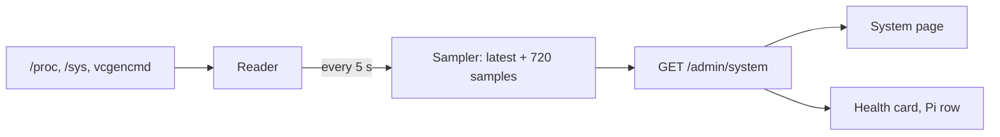

The admin's [System page](/docs/maintenance/system/) shows the Pi itself. The **admin server** reads it, not the engine, for the reason the Logs page has ([ADR 0006](/docs/decisions/0006-json-line-logs/), [ADR 0008](/docs/decisions/0008-system-metrics-from-the-admin-server/)): the numbers matter most when the engine is restarting out of memory or wedged on heat, which is exactly when the engine can't answer.

Code: `apps/admin/src/lib/system/` for the server and the shared schema, `apps/admin/src/app/System/` for the page, `SystemAccordionItem` under the Health card. The reader's tests drive it with fake files and a fake `vcgencmd` (`system.testing.tsx`); the page's render tests drive it with a fake `fetch` and reduced motion (`system.render-testing.tsx`).

## The pieces

| Piece    | File                   | Job                                                                                                                       |
| -------- | ---------------------- | ------------------------------------------------------------------------------------------------------------------------- |
| Protocol | `system.protocol.tsx`  | zod schema of the snapshot; the page parses the response with the same one                                                |
| Reader   | `system.reader.tsx`    | One `sample()`: reads every source once, in parallel, through injected `readFile`, `listDir`, `statfs`, `run` and `os`    |
| Host     | `system.host.tsx`      | Those dependencies on a real machine: `node:fs`, `node:os`, `Bun.spawn`                                                   |
| Sampler  | `system.sampler.tsx`   | A timer, the latest sample, and the last hour as parallel arrays                                                          |
| Route    | `system.routes.tsx`    | `GET /admin/system`: the snapshot as JSON, `cache-control: no-store`; 503 before the first read, 405 for anything but GET |
| Hook     | `useSystemMetrics.tsx` | TanStack Query, `refetchInterval` 5 s, shared by the page and the Health card                                             |
| Meaning  | `system.utils.tsx`     | Thresholds to a status (`ok`, `warning`, `critical`), formatting                                                          |

## Sources

| Reading       | Where                                                         | Notes                                                                                                       |
| ------------- | ------------------------------------------------------------- | ----------------------------------------------------------------------------------------------------------- |
| Temperature   | `/sys/class/thermal/thermal_zone0/temp`                       | Millidegrees; kept to a tenth                                                                               |
| Fan           | `/sys/class/hwmon/hwmon*/fan1_input` where `name` is `pwmfan` | The Pi 5 `FAN` header (the Geekworm H505's fan); RPM                                                        |
| CPU clock     | `/sys/devices/system/cpu/cpu0/cpufreq/scaling_cur_freq`       | kHz, shown in MHz: a capped clock is the visible side of throttling                                         |
| Throttling    | `vcgencmd get_throttled`, as `pi`                             | Needs the `video` group, a Raspberry Pi OS default. Bits 0–3 are now, 16–19 since boot                      |
| Memory        | `/proc/meminfo`                                               | `MemAvailable` is the figure shown; `Cached + Buffers` is said apart; zram swap from `SwapTotal`/`SwapFree` |
| CPU           | `/proc/loadavg`, `/proc/stat`                                 | Busy share = 1 − idle ticks / all ticks between two reads, so the first read has none                       |
| Disks         | `statfs` on `/` and `/mnt/ssd`                                | `bsize × blocks` and `bsize × bavail`; a mount that isn't there is left out                                 |
| Model, uptime | `/proc/device-tree/model`, `os.uptime()`                      |                                                                                                             |

The four `get_throttled` flags, by bit: 0 under-voltage, 1 clock capped, 2 throttled, 3 soft temperature limit; each plus 16 is the same since boot. `0x50005` means under-voltage and throttled, now and since boot.

Every Pi-only source is optional. Off the Pi, or when `vcgencmd` fails, the reading is `null` and `sources.<name>` says why (`unavailable`, with a message the page shows). Load, uptime, total memory and the root disk fall back to `node:os` and `statfs`, so the page works on a development machine; available memory is `null` there, since macOS has no `MemAvailable` and its free figure would read as a full machine.

## Timings and limits

- **Read every 5 s** (`SYSTEM_SAMPLE_INTERVAL_MS`), from server start, whether or not a page is open: one reader serves every page, and the charts have history the moment the page opens. A read in flight is never doubled by the next tick.
- **720 samples kept** (`SYSTEM_HISTORY_SAMPLES`), one hour, as four parallel arrays: time, temperature, available memory share, CPU busy share. About 40 KB per response.
- **Stale after 15 s** (`SYSTEM_STALE_AFTER_MS`): the snapshot carries `ageMs` by the server's clock, so the page needs no clock agreement with the Pi (a booth offline has no NTP) to say **Not updating**.
- **Polling, not a socket.** Five seconds on a LAN needs no push, and TanStack Query already gives the retry, the background refetch and the "keep the last data on error" the other cards use.

## Thresholds

| Reading      | Warning             | Critical                               |
| ------------ | ------------------- | -------------------------------------- |
| Temperature  | 70 °C               | 80 °C, where the Pi 5 lowers its clock |
| Throttling   | Any flag since boot | Any flag now                           |
| Memory free  | under 15 %          | under 5 %                              |
| Disk free    | under 15 %          | under 5 %                              |
| Load (1 min) | over the core count | over twice the core count              |

The Health card counts only a **critical** Pi as unhealthy; warnings are shown, not counted, like paper low on the printer.

## The page

Seven shadcn cards on a 12-column grid: the Software panel first (no reading: the release and its updates, with a progress gauge drawn like the temperature's, see [Updates](/docs/architecture/updates/#from-admin)), then temperature leading the readings: a radial gauge (recharts through the shared `ChartContainer`) with an area chart of the range, the throttle flags as a table, memory with `Progress` bars and an area chart, CPU with a load bar chart against the core count, storage as a table, then the Power panel (no reading: three actions, see [Power](/docs/architecture/access-control/#power)). Numbers tween to each new reading with anime.js (`System.motion.tsx` holds every duration), the panels settle in once, a status that worsens pulses once; `prefers-reduced-motion` turns all of it into direct updates. The charts never animate: a line that springs every 5 s reads as flicker.
