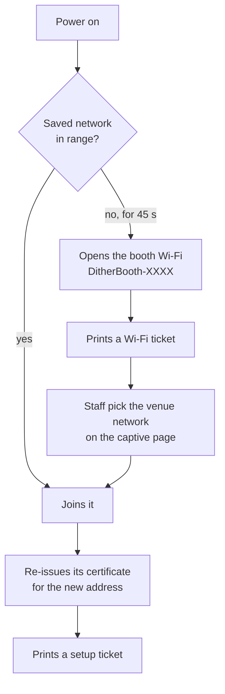

import { Aside, Steps } from "@astrojs/starlight/components";

The booth is designed to be set up **without a laptop**. The printer is its only output before the iPad is connected, so everything you need arrives on paper.

## What the booth does at power-on

1. **Network.** NetworkManager joins any saved network in range. If none is around for **45 seconds**, the booth opens its own Wi-Fi.
2. **Certificate.** Before the apps start, `ditherbooth.service` re-issues the TLS certificate if the booth's address changed. The booth CA stays the same, so iPads that already trust the booth keep working.
3. **Ticket.** Once the printer can print, the engine prints a ticket. It does this **once per power-on** and again whenever the booth's address changes. Out of paper? Load a roll: the ticket prints as soon as the printer is ready.

## Steps

<Steps>

1. **Load paper, close the cover, power the printer and the Pi.**

   Wait for a ticket. On a saved network it's a **setup ticket**, headed with the network's name. With no saved network it's a **Wi-Fi ticket**: follow [Wi-Fi at a venue](/docs/venue/wifi/#no-saved-network-the-booth-wi-fi-opens) first, then come back here.

2. **Join the iPad to the same network as the booth.**

   The setup ticket names it. The iPad and the booth must be able to see each other on the network (see [venues that keep devices apart](/docs/venue/wifi/#the-venue-wi-fi-keeps-devices-apart)).

3. **Scan the ticket's first QR with the iPad camera.**

   It opens the **setup page** at `http://<booth address>:3003`.

   - **The iPad already trusts the booth:** the page shows **Open the Shutter** straight away, plus links to the Darkroom and admin.
   - **New iPad:** the page walks you through trusting the booth once. See [Connect a device](/docs/venue/connect-a-device/).

4. **Open the Shutter and lock the iPad in kiosk mode.**

   Use the Home Screen icon if you made one, then start Guided Access. See [Kiosk mode](/docs/venue/connect-a-device/#kiosk-mode).

5. **Tune and test the print in the Darkroom.**

   Tap the logo at the top left of the landing screen **four times within two seconds**, enter the PIN, then **Test print**. See [Tune the prints](/docs/venue/tune-prints/).

6. **Check the Control Center in admin.**

   On your own phone, open admin from the setup page's link (or `https://<booth>.local:3002`). Health, Printer and Network should be green, and the Booth screen card should show the Shutter connected.

7. **Do a full visit yourself.** Photo, slot machine, photo receipt, lottery ticket.

</Steps>

<Aside type="note" title="Which address?">
  The setup page and the tickets prefer `https://<hostname>.local:3000` when
  the iPad can resolve it, because that name survives the next venue's new IP.
  A Home Screen icon made from the `.local` link keeps working from venue to
  venue. The IP link always works on the current network.
</Aside>

## If the ticket doesn't print

| What you see                                | What to do                                                                                                                                                                                                                               |
| ------------------------------------------- | ---------------------------------------------------------------------------------------------------------------------------------------------------------------------------------------------------------------------------------------- |
| Nothing prints, printer light off           | Printer power brick, power switch.                                                                                                                                                                                                       |
| Nothing prints, printer on                  | Paper loaded? Cover fully closed? The ticket waits for a printer that can print. Then check the USB cable.                                                                                                                               |
| Still nothing after 3 minutes               | SSH in (`ssh pi@booth.local`, or connect to the booth Wi-Fi and use `ssh pi@10.42.0.1`) and run `booth qr`: it prints the same QR in the terminal. Then `booth doctor`.                                                                  |
| A ticket prints, but the QR “can't connect” | The iPad isn't on the booth's network, or the network has no IPv4 route to the booth. Scan the **second** QR (`http://<hostname>.local:3003`). See [the IPv6-only case](/docs/venue/wifi/#the-ipad-shows-not-connected-to-the-internet). |

Need a ticket again later? Admin's Control Center → **Network** card → **Print setup ticket**, or `booth qr` over SSH for the same QR on screen.
